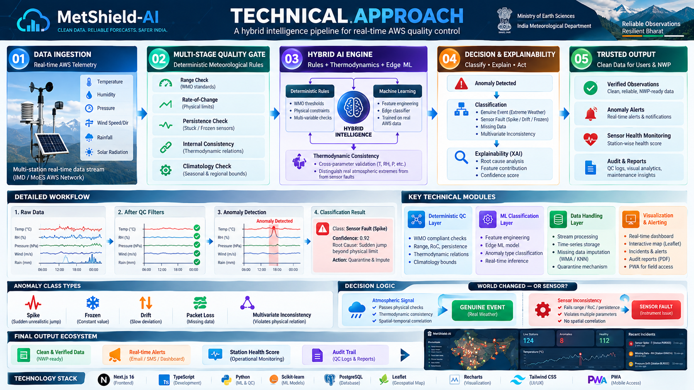

# Shivam Kumar Mehta — Portfolio & App Distribution Hub (`all-websites-3d`)

Clean 2D developer showcase & software distribution hub featuring a Light/Dark Apple-inspired studio UI, automated GitHub Releases syncing, and an interactive Three.js 3D orbit HUD centerpiece.

## Live Site

- **Portfolio & Downloads:** **[shivamkumarmehta64-sketch.github.io/all-websites-3d](https://shivamkumarmehta64-sketch.github.io/all-websites-3d/)**
- **Black Browser (Latest Release):** [Installer & Portable ZIP](https://github.com/shivamkumarmehta64-sketch/Black-Firefox/releases/latest)
- **LinkedIn:** [linkedin.com/in/shivam-kumar-mehta](https://www.linkedin.com/in/shivam-kumar-mehta)
- **GitHub:** [github.com/shivamkumarmehta64-sketch](https://github.com/shivamkumarmehta64-sketch)

---

## Architecture & Highlights

- **Light / Dark Apple Studio UI** — Adaptive `data-theme` (`dark` / `light`) persisted in `localStorage` with `prefers-color-scheme` detection, frosted navigation, and category filters (`All`, `AI & Web`, `Windows Desktop`, `Cyber Forensics`).
- **Interactive 3D Orbit HUD** — Lightweight Three.js wireframe core (`initHero3D`) that responds to pointer parallax, pauses when scrolled off-screen, and respects `prefers-reduced-motion`.
- **Automated `data/releases.json` Sync** — Scheduled GitHub Actions workflow (`.github/workflows/sync-releases.yml`) keeps release tags, asset sizes, and `.exe` download URLs synchronized across repositories without hitting client-side API rate limits.
- **Embedded Preview & Case Study Modal** — Live iframe preview for `MetShield-AI`, architectural case study view for `aerotech`, and shareable `#project-id` deep links.

---

## Featured Projects

| Project | Category | Status | Repository |
| :--- | :--- | :--- | :--- |
| **MetShield-AI** | AI & Web (MoES WMO-No. 8 QC) | Active | [`MetShield-AI`](https://github.com/shivamkumarmehta64-sketch/MetShield-AI) |
| **Black Browser** | Windows Desktop (C++ / WebView2) | Active | [`Black-Firefox`](https://github.com/shivamkumarmehta64-sketch/Black-Firefox) |
| **BlackTube** | Windows Desktop (.NET 4.8 / WebView2) | Active | [`BlackTube`](https://github.com/shivamkumarmehta64-sketch/BlackTube) |
| **Quantum Drone GCS** | Cyber Forensics & PQC Telemetry | Active | [`quantum-drone-sih`](https://github.com/shivamkumarmehta64-sketch/quantum-drone-sih) |
| **Cinematic Birthday** | Interactive 3D Web (Next.js / R3F) | Active | [`cinematic-birthday`](https://github.com/shivamkumarmehta64-sketch/cinematic-birthday) |
| **aerotech** | Cyber Forensics & Network Audit | Active | [`aerotech`](https://github.com/shivamkumarmehta64-sketch/aerotech) |
| **Blue Browser (Tauri)** | Cross-Platform Rust Browser | **Archived (`v0.1.0`)** | [`Blue-Browser-Tauri`](https://github.com/shivamkumarmehta64-sketch/Blue-Browser-Tauri) |
| **Electronics Calculator** | ECE Scientific Android App | **Archived (`v1.0`)** | [`Electronics_Calculator`](https://github.com/shivamkumarmehta64-sketch/Electronics_Calculator) |

---

## Visual Preview



---

## Run & Verify Locally

```bash
npm start      # Serves at http://localhost:8080/
npm run check  # Runs node --check on main.js and server.js
```

## License

MIT License — see [`LICENSE`](./LICENSE).
